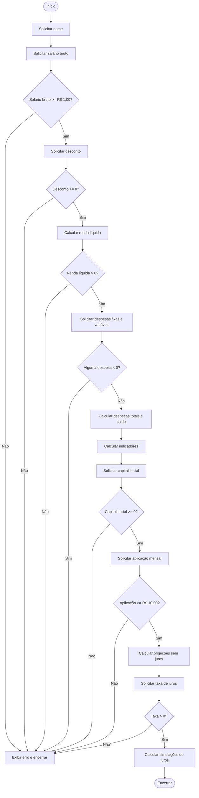

# 03 — Fluxograma

O fluxograma abaixo representa o fluxo principal e as validações implementadas na v1.1.1.

## Observações

- O bloco de despesas permite despesas totais maiores que a renda líquida; o saldo pode ser negativo.
- O diagrama resume as decisões. Entradas não numéricas e valores não finitos ainda não têm tratamento específico nesta versão.
