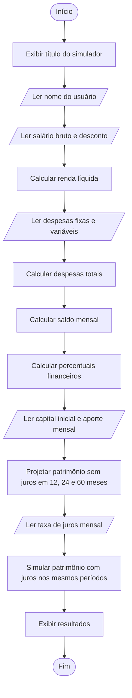

# 03 — Fluxograma

O fluxograma representa a sequência principal do Simulador Financeiro Pessoal. Ele pode ser visualizado em leitores de Markdown que ofereçam suporte a Mermaid.

## Observações

- O fluxo é linear: cada etapa acontece na ordem apresentada.
- Não há decisões nem laços de repetição nesta versão.
- O cálculo dos percentuais pressupõe renda líquida diferente de zero.
- A simulação com juros deve usar a fórmula que inclui o capital inicial e os aportes mensais no mesmo horizonte de tempo.
